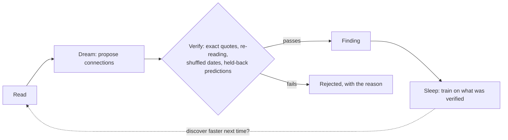
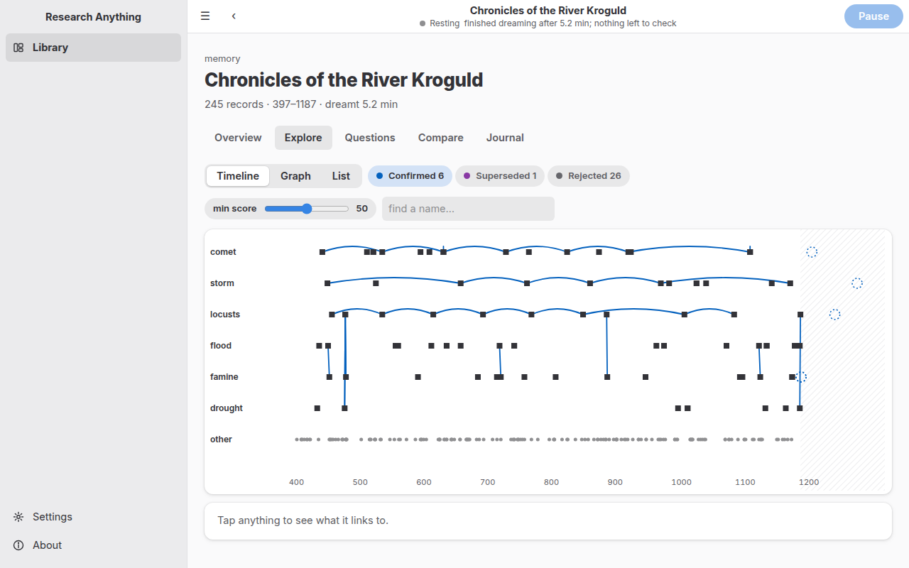
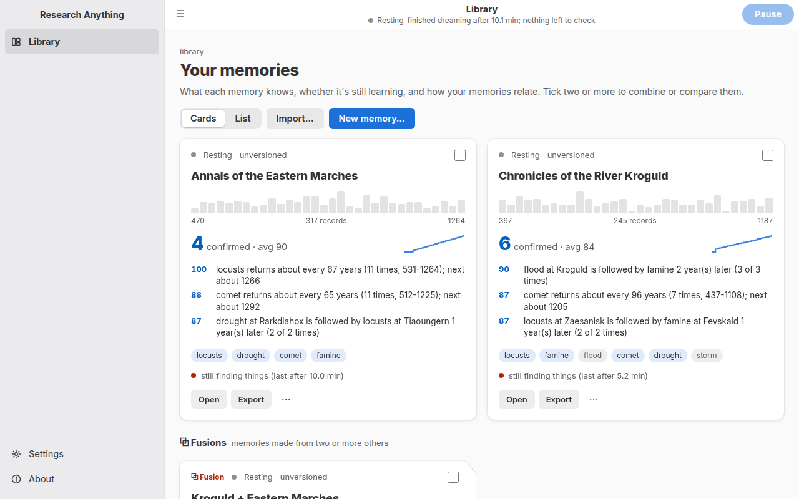
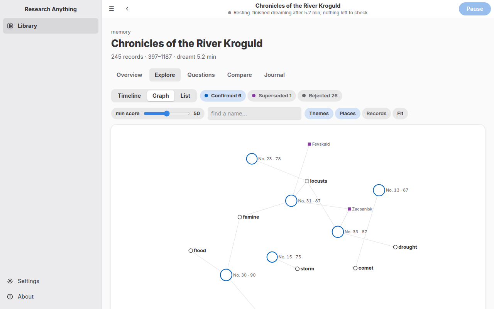
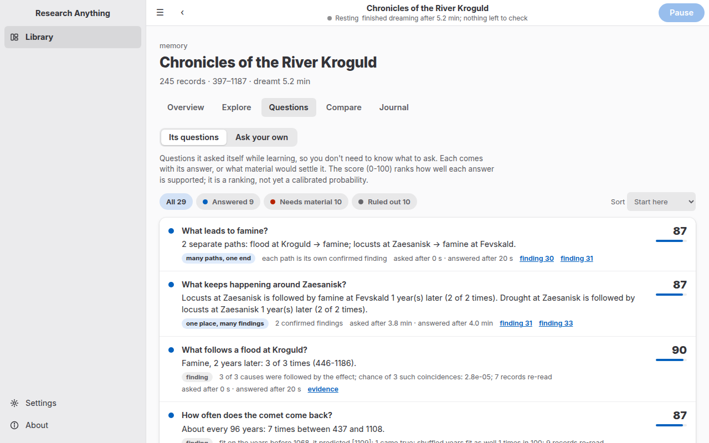
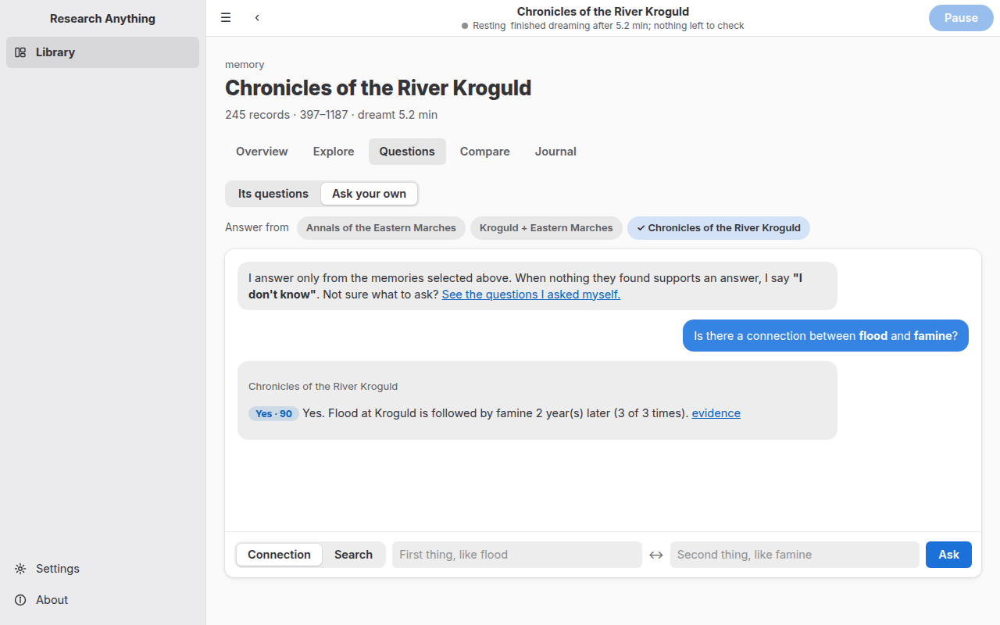

# Research Anything: using an intelligent pipeline to discover hidden patterns

**[Write-up](docs/overview.md)** · **[Results](results/)** · **[Benchmark](chronicles/)** · **[Status](STATUS.md)**

Can an artificial learner find patterns a document collection never states, tell them from coincidence, and get *better at finding them* by sleeping on what it has verified? We study a learner that reads, then dreams up connections and tests each one against the material, then trains only on what survived. Its teachers are its own tests; no labels are needed.





## Who is it for

Anyone sitting on a pile of dated material too big to read closely:

| Who | Their material | A pattern nobody wrote down |
|---|---|---|
| Historians | chronicles, letters, registers | a comet, a famine or a flood that returns on a cycle |
| Journalists | a leaked or released document set | one person behind several names; payments that always follow certain meetings |
| Scientists | years of lab notes or field observations | a failure that shows up weeks after a change of supplier |
| Engineers | incident and maintenance logs | outages that follow one particular kind of change |
| Genealogists | family papers, parish records | one ancestor recorded under several spellings |
| Literary scholars (planned) | an author's works and letters | her characters darkening in the years she struggled |

So far it has been tested on generated material; real collections come next.

## Results so far

On generated chronicles with planted patterns, decoys and invented names:

| | Found | True |
|---|---|---|
| The model asked directly (first test set) | 0% | – |
| Its ideas, untested (first test set) | 65% | 5% |
| **Dreaming with verification** (30 worlds, 122 patterns) | **50%** [42–58] | **71%** [63–79] |

It believed 2 of 60 decoys. **Next: does sleep make it discover faster in unseen worlds?** ([hypotheses](docs/overview.md#hypotheses))

## Rediscovering famous patterns (next)

Some of history's best-known discoveries were patterns scattered across records:

| Discovery | The scattered records | What had to be noticed |
|---|---|---|
| Halley's comet (1705) | centuries of comet sightings | the comets of 1531, 1607 and 1682 were one comet, returning about every 76 years; Halley predicted its return in 1758 |
| The saros (Babylonian astronomers) | eclipse records | eclipses repeat every 18 years and 11 days |
| John Snow and cholera (1854) | dated deaths with addresses | the deaths clustered around one water pump |
| Semmelweis and childbed fever (1847) | deaths in two maternity clinics | far more mothers died in the doctors' clinic than in the midwives' |
| Amartya Sen and the Bengal famine (1981) | food supply, prices and wages | the famine came without a fall in the food supply |

A model would recognise these from memory, so for the tests the records are **disguised**: names replaced, dates shifted. Then the comparison is fair: the model asked directly against Research Anything.

## What it looks like

<table>
<tr><td></td><td></td></tr>
<tr><td align="center">The library: what each memory knows</td><td align="center">Findings as a graph of kinds, places and patterns</td></tr>
<tr><td></td><td></td></tr>
<tr><td align="center">The questions it asked itself, with answers and scores</td><td align="center">Ask: it answers only from what it found</td></tr>
</table>

## Quick start

You'll need Linux, an NVIDIA GPU with at least 6 GB of memory (a laptop GPU is enough), Python 3.12 and [uv](https://docs.astral.sh/uv/).

```bash
uv sync
uvx --from "huggingface_hub[cli]>=0.34,<1.0" hf download ByteDance/Ouro-1.4B --local-dir learner-data/models/Ouro-1.4B
uv run python -m chronicles.generator splits --out worlds
uv run python experiments/phase3_read_worlds.py worlds/val/val-000
uv run python experiments/phase3_dream.py worlds/val/val-000
```

## Collaborate

We'd welcome researchers in learning and memory, statistics, NLP and the digital humanities. You could test your own discovery method on the benchmark, try a consolidation method against our hypotheses, or run a rediscovery test on a collection from your field. Open an issue.

## License

The code is licensed under the **GNU Affero General Public License, version 3 or later** ([LICENSE](LICENSE)). If you change it and share it, *or run it as an online service*, your changes must be shared under the same licence. What you learn with it (memories, findings, mindpacks) is yours. Models are downloaded separately under their own licences, and none are included here.

## Citation

To be added with the first preprint.
